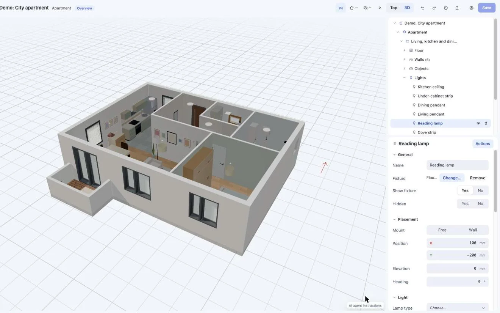
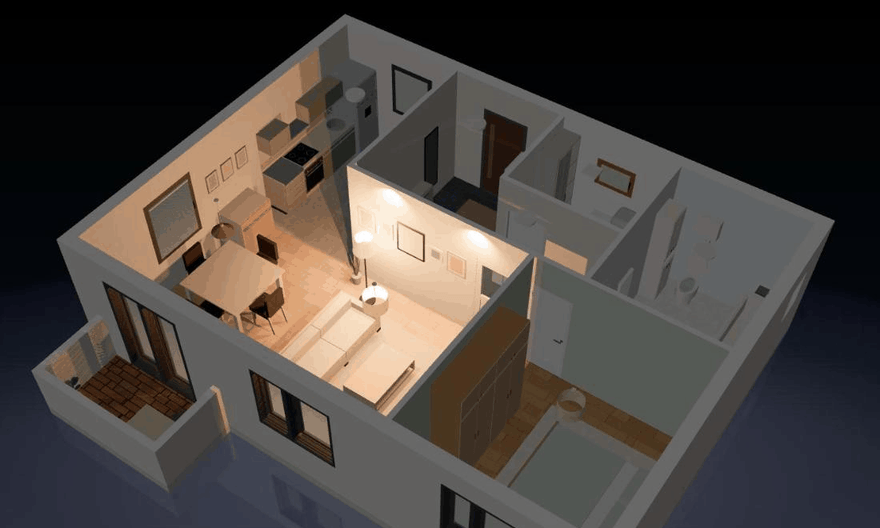

# Homeplan

  
  

A local editor for an open-top 3D model of your home: draw rooms from measured dimensions, raise and merge walls, furnish, light, and export images. It also ships as a Home Assistant app and a Home Assistant integration that shows the house in a sidebar panel. Read more about the project, with screenshots of everything it can do, on [the Homeplan website](https://sokarovski.github.io/ha3d-floorplaner/).

## Browser agents

Too lazy to drag and drop things around to build your house? Don't let that put you off. Open any AI-powered browser, or point Claude Code at the Floor Builder. Send it photos of your rooms and a sketch of your floor plan, and ask it to follow the **AI agent instructions** and use your images. It will build your home in minutes.

For developers: the agent finds everything through `window.homeplan.describe()` in the builder page (tools, schemas, examples and guides), and the starting guide is [public/agent.md](public/agent.md). The website has [step-by-step guides for Claude in Chrome, Claude Code and other agents](https://sokarovski.github.io/ha3d-floorplaner/possibilities.html#builder-agents).

## Requirements

- Node.js 20.19 or newer (Node 24 LTS recommended) and npm 11.
- A current Chromium-based browser on macOS (the reference setup); WebGL 2 is required.
- Blender is **not** needed. Homeplan does not use it for building, viewing or Home Assistant; it only powers an experimental photorealistic render of the house, if you want one (Blender 4, found automatically at `/Applications/Blender.app`, or set `BLENDER_PATH`).

## Home Assistant app

The builder also runs as a Home Assistant app: add this repository under **Settings → Apps → Install app**, then install **Homeplan**. The Supervisor builds the image on the device from the root `Dockerfile`; the app stores its houses in its private `/data` folder (included in HA backups), opens only through the HA sidebar (ingress), and announces itself to the integration through Supervisor discovery. On first start it creates three demo houses. User documentation is in [DOCS.md](DOCS.md); the packaging and discovery contract is in [publishing](spec/home-assistant/publishing.md#app-packaging-and-ingress) and the runtime settings in [deployment](spec/delivery/deployment.md#home-assistant-app).

## Integration

The Home Assistant viewer ships as the **Homeplan** custom integration in [`custom_components/homeplan/`](custom_components/homeplan/README.md). It hosts the 3D panel, keeps private copies of saved houses and the HA bindings, and keeps working when the builder is stopped. Install it through **Settings → Marketplace** (HA 2026.11+) from the generated integration repository, or manually from the release ZIP; the integration's own instructions are in [packaging/ha3d/README.md](packaging/ha3d/README.md), which becomes that repository's README. `npm run ha:package` builds the release ZIP (`dist/homeplan-<version>.zip`, files at the ZIP root), the `homeplan.zip` release asset and the Marketplace repository tree `dist/ha3d/`. No Node/Vite runtime is needed on HA. Runtime and storage behavior are specified in [production integration](spec/home-assistant/production-integration.md).

## Commands

| Command | What it does |
| --- | --- |
| `npm install` | Install dependencies (pinned in `package-lock.json`) |
| `npm run dev` | Start the backend (port 4310) and the Vite dev server (http://localhost:5173) together |
| `npm run build` then `npm start` | Build the SPA and serve app and API from one origin (http://localhost:4310) |
| `npm run lint` / `npm run typecheck` | ESLint (no inline disables allowed) and strict TypeScript for app and server |
| `npm run format` / `npm run format:check` | Format with Prettier, or only check the formatting |
| `npm run seed:stress` | With the backend running, create a 20-room furnished house for performance checks |
| `npm run seed:demo` | With the backend running, create a demo house with shared walls, a door, a window, and a guide |
| `npm run geometry:walls` | Run the wall-merge scenarios (Touching, Full clash, corners, roof cuts, …) and write SVGs to `.homeplan-data/debug/` |
| `npm run editor:selection` | Check Move/Rotate selection: Off acts on the existing selection; On selects a different clicked target and returns; hover never selects |
| `npm run agent:check` | Check browser-agent contracts and isolated editing/save workflows with real commands and template assets |
| `npm run agent:templates` | Check template import, draft/version authoring and placement against the real backend in temporary storage |
| `npm run templates:build` | Regenerate and validate the built-in glTF templates in `server/builtin-templates/` |
| `npm run demo:build` | Regenerate and check the demo house documents in `server/demo-houses/` (deterministic), which the server seeds into an empty data directory on first start |
| `npm run seed:demo-houses` | With the backend running, create the demo houses that are missing (`-- --replace` rebuilds them in place, `-- --dry-run` only checks) |
| `npm run materials:build` | Regenerate the built-in texture images in `server/builtin-materials/` (deterministic) |
| `npm run materials:check` | Check the built-in textured presets, their served images, snapshot freezing and read-only rules |
| `npm run yards:check` | Check yards: Add yard, pathways, no slab, fences and gates along the walls, the fence templates, indoor mask, exterior, tree |
| `npm run build:ha-viewer` | Build/stage the HA viewer and stable loader; export shared schemas |
| `npm run ha:package` | Build and verify the integration release ZIP `dist/homeplan-<version>.zip` (files at the ZIP root, from an allowlist), the `homeplan.zip` release asset and the generated Marketplace repository tree `dist/ha3d/` |
| `npm run version:check` | Check that the integration's version copies equal `package.json` `version` |
| `npm run brand:build` | Render every brand image (integration, app, favicon, social preview) from `brand/ha3d-logo.svg` |
| `npm run ha:check` | Run source and isolated HA checks; set `HOMEPLAN_HA_PYTHON` to the documented HA check environment |
| `npm run demo:ha-cards` | Build the Home Assistant cards bundle of the website's live demo from home-assistant/frontend at a pinned commit (Node 24 + pnpm through `npx`; checkout in `.cache/ha-frontend/` or `HOMEPLAN_HA_FRONTEND_DIR`) into `dist/live-demo-public/ha-cards/`; kept when up to date |
| `npm run demo:data` | Write the live demo's static data (the demo city apartment, its built-in templates and textures, the demo bindings) into `dist/live-demo-public/data/` (deterministic) |
| `npm run site:build` / `npm run site:preview` | Build the showcase website and its live demo into `dist/website/` (runs `demo:ha-cards` and `demo:data` first), or serve it at http://localhost:4180/ha3d-floorplaner/ |
| `npm run styles:sync` | Regenerate the stylesheet imports in `src/design-system/styles/app.tw.css` |

`npm run build:ha-viewer` also makes the production frontend offer available on the builder; see [Integration](#integration) for the release packaging.

The design-system workbench is at `/ds` (unlisted).

## Configuration

| Variable | Default | Meaning |
| --- | --- | --- |
| `DATA_DIR` | `.homeplan-data/` in the repository | Storage root: `data/` (houses), `trash/`, `config/` |
| `PORT` | `4310` | Backend port |
| `HOST` | `localhost` | Bind address (exposing it on a network is an explicit choice; there are no accounts) |
| `HOMEPLAN_BASE_PATH` | `/` | Base path for the SPA and API |
| `HOMEPLAN_SEED_DEMOS` | on | `0` or `false` turns off creating the three demo houses on the first start of a data directory that has never held a house |
| `BLENDER_PATH`, `BLENDER_DEVICE`, `BLENDER_SAMPLES` | auto, `CPU`, `64` | Experimental photorealistic render (optional, not needed otherwise) |

As a Home Assistant app the server runs from the root `Dockerfile` with `DATA_DIR=/data` and port `8099` behind ingress; see [deployment](spec/delivery/deployment.md#home-assistant-app). `npm run app:check` validates the app packaging (`config.yaml`, `Dockerfile`, `repository.yaml`, `DOCS.md`).

## Data, backup, and restore

Each house is a folder `DATA_DIR/data/<house-id>/` containing `house.json`, its images and templates, and a Git repository with every explicit Save as a revision. To back up a house, copy its folder (including `.git/`). To restore, copy it back into `DATA_DIR/data/` while the app is stopped; it appears on the Houses screen. Deleted houses go to `DATA_DIR/trash/` and can be restored from the Trash view.

## Third-party data

The built-in object templates (`server/builtin-templates/`, from `npm run templates:build`), the built-in textures (`server/builtin-materials/`, from `npm run materials:build`, procedural) and the demo houses (`server/demo-houses/`, from `npm run demo:build`) are generated by this project's own scripts; they contain no third-party models, photos or textures. Third-party code comes from the npm dependencies pinned in `package-lock.json`, each under its own licence. The HA viewer bundle includes some of them; `npm run build:ha-viewer` collects the licence texts of every bundled package into `THIRD_PARTY_NOTICES.md`, which ships with the integration (`custom_components/homeplan/THIRD_PARTY_NOTICES.md`).

## License

MIT; see [LICENSE](LICENSE).
