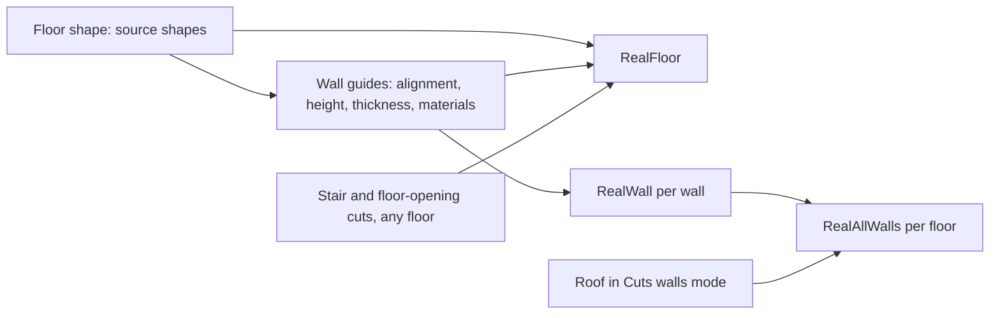

# Geometry groups, guides, and derived real geometry

Updated: 2026-11-19.

Status: resolved ([D03](../../decisions.md#d03-coordinates-units-and-floor-local-geometry), [D04](../../decisions.md#d04-footprints-walls-and-stable-boundaries)). Field names and kernel details are implementation conventions.

## Authored guides and derived geometry

The owner's model separates what the user draws from what is rendered:

| Layer | What it is | Persisted? |
| --- | --- | --- |
| **Floor shape** (guide) | The area's basic contour: source shapes with local transforms | Yes, as editable data |
| **Wall guides** | Walls extruded from floor-shape edges. Each wall has an alignment (inside, outside, or center), height, thickness, materials, and hosted objects | Yes, as editable data |
| **RealFloor** (derived) | The floor polygon/mesh built from the floor shape and the wall settings | No; regenerated |
| **RealWall** (derived) | One wall's own solid: thickness band from alignment, height, openings. Used for picking and provenance | No; regenerated |
| **RealAllWalls** (derived) | The floor-level compound mesh: all RealWalls merged where they clash or touch, contact faces removed, room-side materials, the roof's clipping (and walls risen to it), caps. This is what is rendered | No; regenerated |

Data flows one way:



There are no wall-driven floors. A derived result never writes back into a guide. Editing what the user sees always routes to the guide that produced it.

## Group and local geometry model

Every placeable semantic element is a group with its own local frame, even if it holds a single part. Children have positions and rotations relative to the group, and the group has a placement and its supported rotations relative to its parent. Moving or rotating a parent carries its children without rewriting their coordinates.

```text
House
Building floor (one independently viewed level; placement relative to the house, Phase 16)
  Area (placement relative to the building floor)
    Floor shape group (the area's frame)
      Source shapes: rectangle, circle, polygon
      Carpets (Floorable): own position and rotation in the area; shapes in the carpet's frame
    Walls (each references a source edge of the floor shape)
      Hosted openings (Wallable)
      Wall features (boxes and niches): shapes in the wall face's frame
    Area objects (object groups reference members by ID; stairs and floor openings included), lights
```

Groups are semantic document nodes. [Wall features](wall-relief-groups.md) and [object groups](object-groups.md) are specified separately; the floor's light groups and guides sit beside its areas. Live Three.js groups, meshes, and GPU resources belong to the renderer and are never serialized.

Transforms compose in this order: child-local → group → area → active floor → renderer conversion. Geometry is compiled in the owning group's frame, so a rigid area move reuses its local union and only updates world bounds, picking, and neighboring shared-wall relationships.

## Dimensions position and rotation

- **Shape parameters:** rectangles have width and height, circles a radius, and polygons explicit vertices with stable vertex IDs. Triangles are three-vertex polygons.
- **Group bounds:** a group's width, height, and depth are derived from its children's bounds. Overlaid planes do not gain slab thickness.
- **Placement:** store one authoritative transform plus dimensions. Derive left, right, top, and bottom bounds rather than storing contradictory values.
- **Footprint rotation:** footprint shapes rotate in their common plane. Tilting a whole area into a sloped plane is not supported.
- **Resizing:** resizing a group invokes the element's own resize rules. A window is never scaled without its template's resize rules ([object templates](object-templates.md)).

Axis names and signs, the angle convention, and pivots are implementation conventions ([D03](../../decisions.md#d03-coordinates-units-and-floor-local-geometry)). Camera orbit never changes transforms.

## Coordinate conventions

Implementation conventions chosen at implementation start ([D03](../../decisions.md#d03-coordinates-units-and-floor-local-geometry)); schemas live in `shared/domain/schemas/`.

- **Plan axes:** `x` to the right, `y` up the plan (away from the viewer in Top view), height `h` up from the active floor's finished-floor plane. The renderer maps `(x, y, h)` mm to Three.js `(x/1000, h/1000, −y/1000)` m.
- **Angles:** degrees, counterclockwise positive in plan (`rotationDeg`). North (`northRotationDeg`) is the exception: clockwise from plan up, as in the house model.
- **Transforms:** an area places its local frame with `positionMm` and `rotationDeg` (rotation about the area origin). Shapes and carpets place theirs the same way inside the area. Composition is child-local → shape → area → floor.
- **Rectangles and circles:** `positionMm` is the center; rectangles rotate about their center. Rectangle edges, counterclockwise: `bottom` (−w/2,−h/2)→(w/2,−h/2), `right`, `top` (w/2,h/2)→(−w/2,h/2), `left`.
- **Polygons:** vertices are relative to `positionMm` and stored counterclockwise; a clockwise drawing is reversed on commit, keeping vertex IDs. A polygon edge key is `"<fromVertexId>><toVertexId>"` in counterclockwise order.
- **Wall bands:** walking a source edge in its counterclockwise direction, the area interior is on the left. An **outside** band extends to the right (outward) by the thickness, **inside** to the left, and **center** half each way. Each `spanMm` end is measured from the edge corner it is anchored to and resolved on the current edge length.
- **Openings:** `placement.distanceAlongWallMm` is from the wall span's start to the opening's center; `bottomMm` is from the floor plane to the opening's bottom.
- **IDs:** `<prefix>_<10 lowercase alphanumerics>`; built-in presets use the reserved `builtin_` prefix.
- **Schema IDs:** only form schemas and the stored preferences document carry `$id`. The house schema and every embeddable sub-schema carry none, because API contracts embed them and Ajv rejects a second registration of the same `$id`. Choices are emitted as `anyOf` of `{ const, title }`, which the `select` editor reads alongside `oneOf` and `enum`.

## Geometry kernel and tolerances

Implementation conventions chosen in the wall-merge experiment (`npm run geometry:walls`; [D04](../../decisions.md#d04-footprints-walls-and-stable-boundaries), [D05](../../decisions.md#d05-walls-between-adjacent-areas)); the constants live in `shared/geometry/tolerances.ts`.

- **Library:** `clipper2-ts` 2.0.1 (TypeScript port of Clipper2), used for unions, differences, offsets, and triangulation. Booleans run on `Clipper64` integer paths with the NonZero fill rule.
- **Fixed-point scale:** 1 integer unit = 0.001 mm (1000 units per mm). Results return to millimetres as outer rings counterclockwise and holes clockwise.
- **Contact tolerance:** 0.5 mm. Unions are closed morphologically (miter offset out by 0.25 mm, then back in), so faces within 0.5 mm merge and wider gaps stay visible. After closing, vertices within 0.01 mm of the line through their neighbours are dropped, removing the micro-edges that mitering leaves on faceted circles. Rings that pinch at a single vertex are split, so point contacts stay separate components.
- **On-line tolerance:** 0.01 mm. A boundary segment lies on a source edge or wall face when both of its ends are within this distance of the source line and the directions agree.
- **Sliver length:** 0.5 mm. Boundary intervals, wall pieces, and edge pieces shorter than this are dropped. Interval ends within 0.05 mm of an edge vertex snap onto it, and wall-piece ends within 0.05 mm of each other get a miter join.
- **Circle chord tolerance:** 0.5 mm sagitta. A circle uses `ceil(π / acos(1 − 0.5/r))` segments, at least 8 and at most 4096, with vertices on the circle.
- **Parallel tolerance:** sine ≤ 0.001 (about 0.06°) for miters, opening depth, and detents. Heights within 0.01 mm collapse into one level. Intrusion and opening-conflict flags ignore overlaps under 1 mm².
- **Edge identity after a union:** see [face ownership](shared-walls.md#face-ownership-and-materials). The floor-shape union uses the same recovery against source-shape edges, giving each edge its boundary intervals in mm from its start vertex. A wall's visible extent is its span intersected with those intervals.
- **Corner joins:** where one wall piece ends at the start of another wall piece on a non-parallel edge, both bands are mitered on the line through the intersection of their interior faces and the intersection of their exterior faces. This holds for any thicknesses and alignments, and for walls on circles (Phase 4.1): a face is a line or, on an arc, a circle, and the join point is the intersection nearest the shared corner (line–line, line–circle, circle–circle). Because arc boundary pieces come from the discretized circle, ends involving an arc join within 1 mm (twice the chord tolerance) instead of 0.05 mm. Tangent meetings (parallel directions) need no join. A miter longer than 20 × the larger thickness falls back to square ends (a bevel there is deferred: it needs an extra band vertex and only occurs at near-hairpin angles). Free wall ends (trimmed gaps, unwalled edges) stay square.

## One unit with a physical meaning

All authored lengths use **1 internal unit = 1 mm**, and fractions are valid. Display units change only input and readouts. A meter-based renderer divides by 1000 at its boundary. See [units and grid](units-and-grid.md).

## Floor shape and union

The floor shape is the union of its coplanar source shapes, computed in the group's plane:

- **Overlaps and contacts:** overlapping shapes merge, and shapes that share an edge form one continuous outline.
- **Components and holes:** point contacts and separate shapes give multiple components. Holes produced by the union are kept. The compound region is preserved: it is never filled to its bounding box and never bridged.
- **Explicit openings:** stairs and floor openings (Phase 16.14) are the only explicit way to cut a floor hole. Subtractive shapes are post-MVP.
- **Circles:** circles are discretized within a physical chord tolerance.
- **Invalid results:** an empty or degenerate result keeps the last valid shape and shows feedback.

## Walls extruded from edges

Walls are raised from the floor shape's outline: straight edges and, since Phase 3, circle arcs ([D20](../../decisions.md#d20-walls-on-circles)). "Raised from the outline" is the semantic data model (each wall belongs to an outline piece and its ends are attached along it); the derived RealWall/RealAllWalls geometry is built independently from the wall's band settings. A circle's wall follows the arc, with its ends measured as arc length counterclockwise from the circle's local 0° point. Openings on curved walls are deferred.

| Alignment | Thickness placement relative to the contour |
| --- | --- |
| **Outside** (default) | The contour is the wall's inner face; the thickness extends away from the area. This matches measured interior dimensions. |
| **Inside** | The contour is the wall's outer face; the thickness extends into the area. The clear interior shrinks. |
| **Center** | Half the thickness on each side of the contour. |

**Stable anchoring.** Each wall stores a reference to a source edge plus a span along it:

- A primitive's edge is identified by its shape ID and fixed edge name.
- A polygon's edge is identified by its shape ID and the pair of vertex IDs at its ends.

A union's boundary consists only of pieces of source edges, so a wall always knows where it belongs: its visible extent is its span intersected with the part of its source edge that lies on the boundary.

**Wall ends are attached to the floor's corners** (owner requirement, Phase 3): each end of the span is stored relative to one end of its source edge, `{ anchor: "start" | "end", offsetMm }`. An end at a corner (`offsetMm: 0`) is that corner's vertical line, so resizing the floor shape or moving a vertex moves the wall end with it and never opens a gap. A trimmed end keeps its distance from the corner it was trimmed back from. If the two ends cross after the edge shrinks, the wall is kept and flagged. A straight boundary line made from several source edges gets one wall per piece, and collinear walls with equal settings render seamlessly.

If a wall's source edge is no longer on the boundary, keep the wall and its openings. Mark it as needing repair and exclude it from RealWall until the user reassigns or deletes it. Never remap it to another edge silently.

A source edge may host several walls with non-overlapping spans. Dragging a wall's vertical end line trims its span, Split divides it, and pushing an end line onto the other end removes the wall ([Floor Builder](../screens/floor-builder.md#trim-extend-remove-and-split-walls-with-their-vertical-lines)). None of these change the floor shape.

## RealFloor

Yards (Phase 17.2, [yards](yards.md#derived-geometry)): a yard's RealFloor (its lawn) is also clipped by the RealFloor solids of the floor's rooms (`buildRealFloors`), so a yard drawn around or against the house never lies under or over a room floor; yards add no slab coverage, take no part in RealAllWalls, and their walls are drawn as fence segments (`shared/geometry/yardFences.ts`).

RealFloor is the union of the floor shape and the horizontal footprint of every wall band that lies outside it (outside- and center-aligned walls), minus the cuts of stairs and floor openings that reach the floor ([automatic cutouts](staircase-areas.md#automatic-cutouts)).

- **Without walls,** RealFloor equals the floor shape, and only its edge is rendered.
- **With walls,** RealFloor grows to the walls' outer faces along their actual spans, thickness, and corner joins. This is never a uniform offset of the whole outline.
- **Measured shape unchanged:** the floor shape keeps its measured dimensions. Enlargement exists only in RealFloor.
- **Visible edge:** RealFloor may carry an optional visible edge thickness as a local rendering choice. This does not imply floor-to-floor elevations.

## RealWall and RealAllWalls

Each wall's **RealWall** is its thickness band (from its contour span and alignment), extruded to its height and cut by its openings. The floor's **RealAllWalls** merges every RealWall on the active floor using 2.5D construction:

1. Union the band footprints per height band with 2D polygon booleans.
2. Remove internal and contact faces, keeping stepped tops.
3. Cut openings through the full local depth.
4. Raise walls to the floor's roof and clip them by it, each planar roof piece over its own plan region ([roofs](roofs.md#the-roof-cuts-walls), Phase 19.2).
5. Generate faces with material regions and provenance back to the authored walls.

Arranging areas, tucking, and the merge rules are owned by [arranging areas and merging walls](shared-walls.md). Mesh batching, if any, never changes the geometry.

## Caching

Derived results may be cached with the source revision, schema version, and geometry version, and are invalidated when any input changes. A cache is never a second editable copy.

## Polygon pencil

The polygon pencil draws a closed polygon:

- **Drawing:** click successive vertices in the area plane while the next segment previews.
- **Closing:** click the start vertex or press Enter. A polygon needs at least three non-collinear points. Escape cancels.
- **Validation:** self-intersecting polygons are rejected with feedback.
- **Editing:** the result is a source shape with stable vertex IDs. Vertices can be dragged, inserted, and deleted. Bounding-box resize scales the vertices about the local origin.
- **Precision:** length fields and [measurement guides](measurement-guides.md) place vertices precisely, and Magnetic snapping includes guides. Committed vertices store real coordinates and never depend on a guide.

## Acceptance

- Moving an area carries every descendant and preserves local coordinates and IDs.
- A union of rotated shapes gives the expected outline. Reopening Room Editor restores the source shapes.
- Compound outlines keep their components and holes, with no bounding-box fill or invented bridges.
- An area with no walls renders RealFloor equal to its floor shape. Adding a 200 mm outside wall grows RealFloor by 200 mm along that span only.
- Inside, outside, and center alignment each place the band correctly. Switching alignment regenerates RealFloor/RealWall without changing the floor shape.
- A shape edit that moves an edge inside the union marks its wall as needing repair and keeps the wall's openings.
- A pencil draft can be closed, cancelled, measured in project units, and reopened as editable vertices.
- `1000` units equal one meter in every display unit and renderer adapter.
